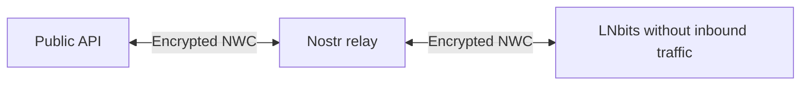

# lnurl-nwc-bridge

A Go service for static product QR codes with prices in EUR. It obtains Lightning
invoices from a private LNbits instance over Nostr Wallet Connect (NWC). The
customer pays the private Lightning backend; this service never sends payments.
LNbits Scrub, if enabled, handles forwarding independently.

This is a standalone Go service, not a general-purpose Lightning wallet or
payment processor. It is intended for a trusted operator running a private
LNbits backend and a public reverse proxy.

## How it works



- **The API is public; LNbits and your funds stay private.**
- **LNbits connects out to the relay.** No inbound ports are needed for NWC.
- **The API can request invoices, not spend money.** It has no wallet admin keys
  or recovery seed. Keep the VPS secure because it still creates invoices.

## Quick start

Requires Go 1.26.11 or newer. The module's `toolchain` directive selects the
patched toolchain automatically when supported by the installed Go command.

```sh
git clone https://github.com/max-gy/lnurl-nwc-bridge.git
cd lnurl-nwc-bridge
cp config.example.json config.json
```

Edit `config.json` for your public hostname, products, and wallet secret-file
paths. Provision each NWC pairing URI separately, then run:

```sh
go test -race ./...
go run ./cmd/lnurl-api -config ./config.json
```

`config.json`, `.env` files, local secrets, and runtime databases are excluded
by `.gitignore`. The example configuration contains placeholders only. Do not
publish real pairing URIs, invoices, payment associations, or production state.

## Features

- Static product endpoints and expiring, server-side EUR-to-sats quotes.
- Exact integer/rational price calculations, rounded **up to whole sats** for
  LNbits compatibility; LNURL and NWC amounts are expressed in millisatoshis.
- CoinGecko BTC/EUR spot prices with a 30-second local cache, provider timestamp
  validation, and no stale-rate fallback.
- Durable embedded bbolt storage; no separate database container.
- NWC subscriptions over persistent WebSockets, authenticated response matching,
  bounded timeouts, and automatic reconnection.
- NIP-44 preferred; legacy NIP-04 requires an explicit per-wallet opt-in.
- BOLT11 signature/network, amount, payment hash, metadata hash, and expiry checks.
- Multiple receiving wallets with separate restricted NWC connections.
- Idempotent successful callbacks, durable protection against repeating uncertain
  requests, global rate limiting, and bounded in-flight requests/quote records.
- Read-only payment status lookup. **No `pay_invoice` operation exists.**

## LNbits prerequisites

1. Run LNbits with a funded and operational Lightning backend on StartOS.
2. Enable its **NWC Provider** extension and point it at your relay's WSS URL.
3. Create a connection for the receiving wallet permitting **only**
   `make_invoice` and `lookup_invoice`. Do not grant spending permission.
4. Securely provision the entire resulting pairing URI into a VPS file.
5. If required, enable Scrub on selected receiving wallets and configure the
   Wallet of Satoshi destination **in LNbits**.

The NWC Provider must support `description_hash` and invoice `expiry`. The relay
must forward NWC kinds 13194, 23194 and 23195 and return the provider's latest
stored info event. NIP-47 request/response events are ephemeral; do not assume
relay storage provides a durable payment queue. The client does not implement
NIP-42 relay authentication: use a relay allowing these connections, optionally
with an appropriate public-key allowlist. Neither endpoint may require an
interactive browser login. A credential embedded in the relay URL is unsupported.

One relay URL per pairing URI is supported. Production connections must use
`wss://` with normal TLS verification. Plain `ws://` is accepted only for
loopback local development. LNbits needs no inbound connections or router
forwarding for NWC.

## Configuration

Copy `config.example.json` to your deployment's configuration location. Never put
actual credentials in that JSON: wallet entries reference secret **file paths**.
The default config path is `/etc/lnurl-api/config.json`; override it with:

```sh
go run ./cmd/lnurl-api -config /absolute/path/to/config.json
```

Required deployment settings:

| Setting | Meaning |
| --- | --- |
| `public_url` | Public HTTPS origin, e.g. `https://pay.example.com`; no path |
| `listen` | Container listener, normally `:8080` |
| `db_path` | Writable persistent bbolt file, normally `/var/lib/lnurl-api/quotes.db` |
| `network` | `mainnet`, `testnet`, `signet`, or `regtest`; must match invoices |
| `wallets.NAME.nwc_uri_file` | File containing the full connection URI |
| `wallets.NAME.allow_legacy_nip04` | Explicit opt-in for older providers; NIP-44 still wins when advertised |
| `products.ID.eur_cents` | Integer EUR cents, e.g. `350` for EUR 3.50 |
| `products.ID.description` | Human-readable LNURL metadata |
| `products.ID.wallet` | Configured receiving-wallet name |

The example enables legacy NIP-04 for compatibility with LNbits versions that
require it. Disable it if the installed provider advertises NIP-44.

Products and wallets are loaded at startup; change the file and restart the
service to change them. Product IDs and wallet names use lowercase letters,
digits, and hyphens. Config validation rejects unknown JSON fields.

Quotes last 120 seconds and invoices request a 300-second expiry by default.
Rates older than 120 seconds are rejected. The public CoinGecko endpoint can
rate-limit or fail; those conditions return explicit errors rather than an old
price. Keep the system clock synchronized.

## HTTP interface

### Static QR destination

```text
GET /lnurl/coffee
```

For a hypothetical 5,000-sat quote:

```json
{
  "tag": "payRequest",
  "callback": "https://pay.example.com/quote/OPAQUE_QUOTE_ID",
  "minSendable": 5000000,
  "maxSendable": 5000000,
  "metadata": "[[\"text/plain\",\"Coffee\"]]"
}
```

Print a QR containing the **LNURL encoding of the stable HTTPS product URL**,
not the expiring callback or a BOLT11 invoice. QR generation is not included.
Prices are fixed per quote (`minSendable == maxSendable`); optional tips are not
implemented in this initial version.

### Invoice callback

```text
GET /quote/OPAQUE_QUOTE_ID?amount=5000000
```

```json
{"pr":"lnbc...","routes":[]}
```

The stored quote determines the amount, receiving wallet, and exact metadata;
later price changes cannot alter it. The API requests an invoice with the SHA-256
hash of that metadata and validates the returned BOLT11 before returning it.
The public hostname in callbacks comes from `public_url`, never proxy headers.

Successful duplicate callbacks return the same invoice while the quote and
invoice remain valid. A transaction durably marks the quote as `creating`
**before** requesting an invoice. If delivery, response, validation, or storage
fails, or the process crashes mid-request, that quote is not automatically
retried: the result might already exist in LNbits. Return to the product URL /
scan the QR again to obtain a new quote. An unreturned invoice may remain unpaid
in LNbits until expiry. This is intentionally conservative, not a claim of
distributed exactly-once execution.

### Optional payment status

```text
GET /quote/OPAQUE_QUOTE_ID/status
```

Returns `{"state":"pending"}`, `{"state":"settled"}`, `{"state":"accepted"}`, or
`{"state":"expired"}` for issued invoices. Before issuance it returns `new` or
`creating`; `creating` can also mean an uncertain request. Settlement uses NWC
`state`/`settled_at`, **not** preimage presence, because some LNbits versions
return placeholder or incoming-invoice preimages before settlement.

The unpredictable quote ID acts as a bearer capability for this limited status
endpoint. Do not log or publish callback URLs. This is not a merchant login or
an order-management system. The payer's wallet learns payment success through
Lightning independently. Polling status adds detection latency, not payment
latency.

### Operations and errors

- `GET /healthz`: process liveness.
- `GET /readyz`: 200 only when every configured NWC client is connected and has
  received compatible provider capabilities; otherwise 503. It does not prove
  backend liquidity, exchange-rate availability, or permission to create an invoice.
- LNURL/business failures return JSON `{"status":"ERROR","reason":"..."}` with
  HTTP 200 for wallet compatibility. Monitor this envelope, not just HTTP status.
  Unknown paths/methods use standard HTTP 404/405.
- Responses use `Cache-Control: no-store`; errors are logged without raw pairing
  URIs, NWC response contents, or provider error messages.

Default limits are global, not per-IP: 5 requests/second, burst 20, and 32
concurrent payment requests. Client-supplied forwarding headers are not trusted.
Use additional reverse-proxy limits to resist connection abuse. Quote requests
also have their own limit: by default, 1 per second with a burst of 10. The API
lowers this limit when the configured request limits or quote storage budget
require it. Quote records are capped at 10,000 by default. Cleanup runs every
minute: unused quotes are removed at expiry; issued or uncertain quotes are
retained for an hour after the later of quote or invoice expiry. This is
short-lived state, not a permanent accounting ledger; LNbits remains
authoritative. bbolt can reuse freed pages but does not automatically shrink
its file.

## Build and test

Go 1.26.11 or newer:

```sh
go test -race ./...
go vet ./...
go build -o lnurl-api ./cmd/lnurl-api
docker build -t lnurl-nwc-api:local .
```

The automated integration tests use a local WebSocket relay and signed/encrypted
NWC messages, plus genuine signed BOLT11 invoices. They do not contact your
wallet or spend sats. Live compatibility with your StartOS/LNbits version and
relay still needs an end-to-end test before printing QR codes.

## Docker deployment under Cosmos

Build the image above on the VPS from a trusted checkout. It runs as UID/GID
`10001:10001`. Prepare host directories and the non-secret configuration:

```sh
sudo install -d -m 0755 /etc/lnurl-api
sudo install -d -m 0700 /etc/lnurl-api/secrets
sudo install -d -m 0700 -o 10001 -g 10001 /var/lib/lnurl-api
sudo install -m 0644 config.example.json /etc/lnurl-api/config.json
sudoedit /etc/lnurl-api/config.json
```

Provision the pairing URI through a secure channel, for example editing its
file without putting the URI into shell history or arguments:

```sh
sudoedit /etc/lnurl-api/secrets/nwc
sudo chown 10001:10001 /etc/lnurl-api/secrets/nwc
sudo chmod 0400 /etc/lnurl-api/secrets/nwc
```

Keep the parent directory root-owned and `0700`. Docker's root daemon can mount
the individual file, and the container's service UID can read its mounted copy.
Add separate files/mounts for additional receiving wallets.

Create a dedicated network and start the API **without a host port**:

```sh
sudo docker network create lnurl-api-net
sudo docker run -d \
  --name lnurl-api \
  --restart unless-stopped \
  --network lnurl-api-net \
  --read-only \
  --cap-drop ALL \
  --security-opt no-new-privileges:true \
  --log-opt max-size=10m --log-opt max-file=3 \
  --mount type=bind,src=/etc/lnurl-api/config.json,dst=/etc/lnurl-api/config.json,readonly \
  --mount type=bind,src=/etc/lnurl-api/secrets/nwc,dst=/run/secrets/nwc,readonly \
  --mount type=bind,src=/var/lib/lnurl-api,dst=/var/lib/lnurl-api \
  lnurl-nwc-api:local
sudo docker network connect lnurl-api-net cosmos-server
```

These are initial provisioning commands: the network/container names must not
already exist. Cosmos can discover CLI-created containers. Add a public
reverse-proxy route for `pay.example.com` targeting `http://lnurl-api:8080`,
without login challenges or response caching. Configure TLS, management access,
the separately deployed relay, and firewall rules according to your hosting
provider's documentation. If Cosmos is named differently, replace
`cosmos-server`.

The pairing URI should identify the same externally reachable WSS relay used by
the LNbits provider. The API connects to that URL too, so no additional private
relay-network attachment is required for this initial deployment. The relay is
deployed separately; no unknown relay image or permissive relay configuration
is bundled here.

Verify mounts and startup:

```sh
sudo docker inspect lnurl-api --format '{{json .Mounts}}'
sudo docker exec lnurl-api wget -qO- http://127.0.0.1:8080/healthz
sudo docker exec lnurl-api wget -qO- http://127.0.0.1:8080/readyz
curl --fail --silent --show-error https://pay.example.com/lnurl/coffee
```

Check `RW` is false for configuration and secret mounts, and true only for the
state directory. `/readyz` fails until the relay and LNbits NWC Provider are ready.
Before printing QR codes, use a real compatible wallet to request and pay a small
invoice, verify LNbits settlement and Scrub separately, and test reconnects.

**Cosmos caveat:** the inspected Compose importer drops short-syntax `:ro`, and
the volume editor submits `ReadOnly: false`. Manage this container's mounts
through CLI/explicit Docker mount configuration and verify them after changes.
Do not overwrite them by saving the Cosmos volume editor.

## Secrets, recovery and scope

- The entire NWC pairing URI is secret, including its client private key.
  Store no LNbits admin keys, LND macaroons, provider private keys, or recovery
  seeds on the VPS.
- Plain host secret files are not encrypted automatically. VPS root and Cosmos
  remain trusted for the restricted API key. A compromised public API can also
  substitute an attacker's invoice; removing spend permission does not protect
  the integrity of a compromised checkout.
- To rotate, revoke the connection in LNbits, securely replace the file, and
  recreate the API container so it mounts the current file inode. Preserve its
  state directory. Avoid placing secret values in Docker environment variables.
- Run a single API process per database; bbolt's file lock rejects concurrent
  processes. Use a local filesystem, not an NFS/shared-volume database.
- Stop the API before making a simple file-copy backup of its database; encrypt
  backups containing credentials or payment associations. Lightning recovery
  material requires its own separate backup procedure.
- No price administration UI, authenticated merchant dashboard, arbitrary
  payouts, durable fulfillment queue, QR generation, or relay server is included.
  The static QR identifies a product, not an individual customer/order.

## Security and contributions

Review the operational limitations above before handling real payments. This
software has automated tests, but no independent security audit or guaranteed
compatibility with every LNbits, relay, or Lightning wallet version.

Do not open a public issue containing credentials, private payment information,
or an unpatched vulnerability. Use the repository's private vulnerability
reporting feature when available. For ordinary bugs and improvements, open an
issue describing the behavior and environment, then keep pull requests focused.
Run `gofmt`, `go test -race ./...`, and `go vet ./...` before submitting changes.
Never include live credentials or production databases in tests or examples.

## License

MIT; see [LICENSE](LICENSE).

## Protocol references

- [LNURL-pay](https://github.com/lnurl/luds/blob/luds/06.md)
- [Nostr Wallet Connect](https://github.com/nostr-protocol/nips/blob/master/47.md)
- [LNbits NWC Provider](https://docs.lnbits.com/extensions/nwcprovider/)
- [LNbits Scrub](https://docs.lnbits.com/extensions/scrub/)
