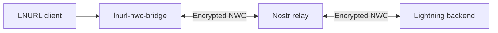

# lnurl-nwc-bridge

A small Go service that exposes LNURL-pay endpoints and obtains Lightning
invoices through Nostr Wallet Connect (NWC). It is designed for static product
links with fiat-denominated prices and a separately operated Lightning backend.

The service requests and looks up invoices; it does not send payments or manage
wallet recovery material.

## Features

- Static LNURL-pay product endpoints, short-lived BTC/fiat quotes, and
  variable-amount donations.
- Multiple receiving wallets through restricted NWC connections.
- NIP-44 support, with optional legacy NIP-04 compatibility.
- Invoice amount, metadata, network, signature, and expiry validation.
- Persistent quote state using embedded bbolt storage.
- Payment-status, liveness, and readiness endpoints.
- Request limits and bounded quote storage.

## How it works



The Lightning backend initiates its own outbound relay connection. The bridge
does not require inbound access to that backend.

## Configuration

See [config.example.json](config.example.json) for the available settings. The
default configuration path is `/etc/lnurl-api/config.json`; another path can be
selected with `-config`.

Set `products_file` to a separate JSON object containing product definitions;
see [products.example.json](products.example.json). Product IDs become the
stable `/lnurl/{product}` endpoints. Each definition specifies a description,
a configured receiving wallet, and either an uppercase ISO 4217 `currency` and
minor-unit `price` or `min_sats` and `max_sats` for a payer-selected amount such
as a donation. For example, `100` means €1.00 with `EUR`, $1.00 with `USD`, or
¥100 with `JPY`.
Restart the service after changing products. Inline `products` in the main
configuration remains supported for compatibility, but cannot be combined with
`products_file`.

NWC pairing URIs are credentials. Configure them through separate secret files,
not directly in the JSON configuration, environment variables, or source
control. Restrict connections to the operations the service requires:
`make_invoice` and `lookup_invoice`.

Production deployments should use HTTPS and secure `wss://` relay connections.
The service listens on port `8080` by default and stores its database at the
configured `db_path`.

## HTTP endpoints

| Endpoint | Purpose |
| --- | --- |
| `GET /lnurl/{product}` | Return LNURL-pay metadata and a quote callback |
| `GET /quote/{id}?amount=...` | Request the invoice for a quote |
| `GET /quote/{id}/status` | Return limited payment status |
| `GET /healthz` | Process liveness |
| `GET /readyz` | NWC connection and capability readiness |

Amounts in callbacks are millisatoshis. Quote IDs are unpredictable bearer
capabilities for their limited callback and status operations; do not publish
or log them unnecessarily.

## Build and test

Requires Go 1.26.11 or newer.

```sh
go test -race ./...
go vet ./...
go build -o lnurl-api ./cmd/lnurl-api
```

A Dockerfile is included for container builds. The runtime uses UID/GID
`10001:10001`; its configuration and secret files should be read-only, while
the database directory must be writable and persistent.

## Operational notes

- Run only one process against a bbolt database.
- Back up configuration and persistent state securely.
- Keep wallet administrator credentials and recovery seeds elsewhere.
- Test compatibility with the selected NWC provider, relay, and wallets before
  handling real payments.
- This project has automated tests but no independent security audit.

## Contributing

Keep changes focused and run `gofmt`, `go test -race ./...`, and `go vet ./...`.
Never include live credentials, private payment information, or production
databases in issues, tests, or examples. Use private vulnerability reporting
for unpatched security issues when available.

## License

MIT; see [LICENSE](LICENSE).

## Protocol references

- [LNURL-pay](https://github.com/lnurl/luds/blob/luds/06.md)
- [Nostr Wallet Connect](https://github.com/nostr-protocol/nips/blob/master/47.md)
- [LNbits NWC Provider](https://docs.lnbits.com/extensions/nwcprovider/)
